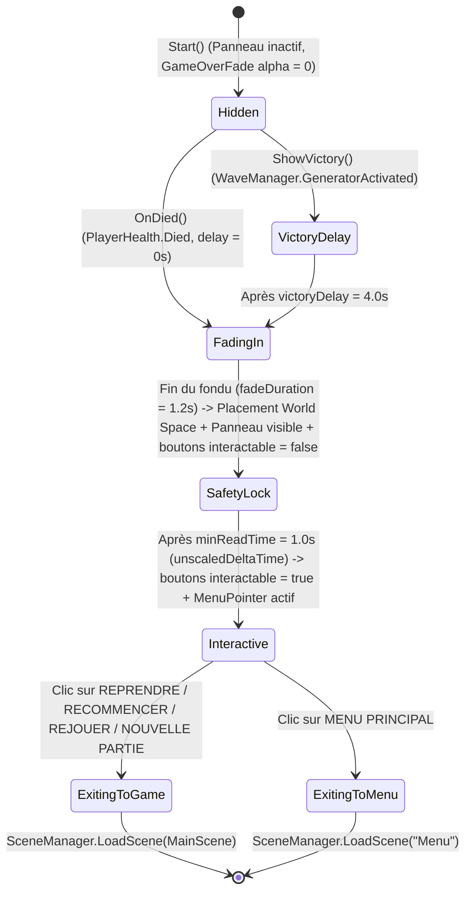

# UX Spec: Menu de Fin de Partie — Terminal BUNKER-OS (`game-over-menu`)

> **Status**: Approved
> **Author**: Équipe Studio + `ux-designer`
> **Last Updated**: 2026-11-09
> **Journey Phase(s)**: Fin de boucle principale (Défaite au combat / Victoire par évacuation / Fin de série en Mode Survie)
> **Platform Target**: Meta Quest 3 (VR Standalone — Pointeur rayon 6DoF `MenuPointer` + Gâchette) & PC Desktop (`DesktopMode` / `DesktopPlayer` — Souris libre + Clic gauche / Clavier)
> **Accessibility Tier**: Standard VR/PC (Assumé — `design/accessibility-requirements.md` absent, défini explicitement dans cette spécification)
> **Referenced GDD / Scripts**: `Assets/Scripts/GameOverUI.cs`, `Assets/Scripts/PauseMenu.cs`, `Assets/Scripts/AmberMenu.cs`, `Assets/Scripts/UiKit.cs`, `Assets/Scripts/MenuPointer.cs`, `Assets/Scripts/MenuButton.cs`, `Assets/Scripts/GameStats.cs`, `Assets/Scripts/WaveManager.cs`, `Assets/Scripts/PlayerHealth.cs`, `Assets/Scripts/Desktop/DesktopPlayer.cs`, `Assets/Scripts/Desktop/DesktopHud.cs`
> **Template**: UX Spec

---

## Purpose & Player Need

### Besoin joueur (Perspective Joueur)
Le joueur arrive sur cet écran immédiatement après un pic de tension dramatique (mort sous les coups de la horde à `0 PV` ou réussite de l'activation du générateur après 5 secondes de maintien du levier au niveau 4) en voulant :
1. **Comprendre instantanément l'issue de sa tentative** (Défaite critique vs Évacuation réussie) sans subir d'interface collée à la rétine qui provoque de l'inconfort visuel en VR.
2. **Prendre connaissance de sa performance à son propre rythme** (zombies abattus, précision des tirs à la tête, barricades posées, niveau ou vague atteinte, temps de survie et éventuel nouveau record) sans craindre qu'un tir réflexe en plein combat ou qu'un compte à rebours arbitraire (`restartDelay`) ne ferme l'écran de force.
3. **Choisir explicitement la suite de sa session** via de vrais boutons interactifs : reprendre au début du niveau atteint (si mort au niveau >= 2 en mode Évasion), recommencer depuis le niveau 1, relancer une série en mode Survie, ou retourner au menu principal (`Menu`).

### Problème résolu par rapport à l'implémentation héritée
L'implémentation initiale de `GameOverUI.cs` collait deux `TextMesh` directement sur la caméra (`head`) par-dessus un quad noir (`GameOverFade`), imposait un rechargement automatique au bout de `15 s` (`restartDelay`), et utilisait des raccourcis invisibles ou ambigus (`Gâchette` pour relancer, `Maintenir B` pendant `1 s` pour recommencer au niveau 1) sans aucun bouton permettant de revenir au menu principal (`Menu`). Ce nouveau design remplace ce texte flottant par un **Terminal BUNKER-OS diégétique en World Space** cohérent avec `MainMenu` et `PauseMenu`.

---

## Player Context on Arrival

| Contexte d'arrivée | Activité immédiatement précédente | État émotionnel & physique supposé | Mode d'arrivée |
|---|---|---|---|
| **Défaite — Mode Évasion (Niveau 1)** | Le joueur se battait au corps-à-corps ou au pistolet dans le bunker initial ; il vient de subir le coup fatal (`PlayerHealth.Died`). | Surpris, frustré ou sous adrénaline ; doigt potentiellement encore en train de presser la gâchette ou le bouton de clic gauche. | Forcé par l'événement `PlayerHealth.Instance.Died`. |
| **Défaite — Mode Évasion (Niveau 2 à 4)** | Le joueur explorait les couloirs, la cuisine, le stockage ou tentait d'atteindre le générateur sous pression ; ses PV tombent à `0`. | Stressé, investi dans sa progression (10 à 20 minutes de jeu) ; souhaite ne pas perdre toute sa progression ou veut retenter le niveau atteint. | Forcé par l'événement `PlayerHealth.Instance.Died`. |
| **Victoire — Mode Évasion (Niveau 4)** | Le joueur a maintenu le levier du générateur pendant `5 s` alors que la horde le traquait (`Zombie.HuntPlayer = true`). Les zombies tombent, les lumières du bunker se rallument pendant `victoryDelay = 4.0f`. | Soulagé, triomphant, essoufflé ; regarde autour de lui le bunker illuminé avant l'apparition du bilan. | Forcé par `WaveManager.GeneratorActivated()` -> `GameOverUI.Instance.ShowVictory()`. |
| **Défaite — Mode Survie (`WaveManager.Endless`)** | Le joueur tenait le plus longtemps possible face à des vagues infinies à difficulté croissante ; il finit submergé. | Compétitif, curieux de vérifier s'il a battu son record (`EndlessRecord.BestTime` / `EndlessRecord.BestWave`). | Forcé par `PlayerHealth.Instance.Died` avec `WaveManager.Endless == true`. |

---

## Navigation Position

Cet écran occupe une position **contextuelle de fin de boucle de gameplay** au sein de la scène `MainScene` :

```text
[Scène "Menu" : MainMenu (BUNKER-OS // MENU)]
       │
       ├──> SOLO > ÉVASION (WaveManager.Endless = false)
       │         └──> [Scène "MainScene" : Gameplay actif]
       │                    ├──> (Bouton Menu / Échap) ──> [PauseMenu (BUNKER-OS // PAUSE)]
       │                    └──> (PV <= 0 ou Générateur activé) ──> [GameOverUI (BUNKER-OS // ALERTE CRITIQUE | EXTRACTION)]
       │                                                                  ├──> REPRENDRE AU NIVEAU X ──> Recharge "MainScene" (ResumeLevel = X)
       │                                                                  ├──> RECOMMENCER / REJOUER ──> Recharge "MainScene" (ResumeLevel = 0)
       │                                                                  └──> MENU PRINCIPAL ─────────> Charge "Menu" (ResumeLevel = 0)
       │
       └──> SOLO > VAGUES INFINIES (WaveManager.Endless = true)
                 └──> [Scène "MainScene" : Gameplay Survie]
                            └──> (PV <= 0) ──> [GameOverUI (BUNKER-OS // ALERTE CRITIQUE — Mode Survie)]
                                                     ├──> REJOUER ────────> Recharge "MainScene" (Endless = true, ResumeLevel = 0)
                                                     └──> MENU PRINCIPAL ─> Charge "Menu" (ResumeLevel = 0)
```

Exclusion mutuelle avec `PauseMenu` :
- Si `PlayerHealth.Instance.IsDead` ou `WaveManager.Instance.Victory` ou `GameOverUI.PanelOpen` est vrai, `PauseMenu.Pause()` est bloqué.
- Si `PauseMenu.Paused` est vrai au moment exact où `GameOverUI` se déclenche, `PauseMenu.Resume()` est appelé automatiquement pour fermer le panneau de pause avant d'afficher `GameOverUI`.

---

## Entry & Exit Points

### Points d'entrée (`Entry Sources`)

| Source d'entrée | Déclencheur (`Trigger`) | Délai d'entrée | Contexte et données transportées |
|---|---|---|---|
| **Gameplay — Mort en Mode Évasion (Niveau 1)** | `PlayerHealth.Instance.Died` (`!WaveManager.Endless && WaveManager.Level <= 1`) | Immédiat (`delay = 0f`), suivi de `fadeDuration = 1.2f` | `resumeLevel = 0`, compteurs `GameStats`, variante visuelle **Défaite (Rouge/Ambre)**, 2 boutons. |
| **Gameplay — Mort en Mode Évasion (Niveau >= 2)** | `PlayerHealth.Instance.Died` (`!WaveManager.Endless && WaveManager.Level >= 2`) | Immédiat (`delay = 0f`), suivi de `fadeDuration = 1.2f` | `resumeLevel = WaveManager.Level` (`2`, `3` ou `4`), compteurs `GameStats`, variante visuelle **Défaite (Rouge/Ambre)**, 3 boutons. |
| **Gameplay — Mort en Mode Survie** | `PlayerHealth.Instance.Died` (`WaveManager.Endless == true`) | Immédiat (`delay = 0f`), suivi de `fadeDuration = 1.2f` | `resumeLevel = 0`, appel à `EndlessRecord.Submit(WaveManager.Level, GameStats.Time)`, drapeau `EndlessRecord.NewRecord`, variante visuelle **Défaite (Rouge/Ambre)**, 2 boutons. |
| **Gameplay — Victoire en Mode Évasion (Niveau 4)** | `WaveManager.GeneratorActivated()` appelle `GameOverUI.Instance.ShowVictory()` | `victoryDelay = 4.0f` (contemplation du bunker rallumé), suivi de `fadeDuration = 1.2f` | `resumeLevel = 0`, compteurs `GameStats`, variante visuelle **Victoire (Vert/Or)**, 2 boutons. |

### Points de sortie (`Exit Destinations`)

| Destination de sortie | Déclencheur (`Trigger`) | État modifié avant transition | Notes |
|---|---|---|---|
| **`MainScene` (Reprise au niveau atteint)** | Clic sur le bouton `REPRENDRE AU NIVEAU X` (uniquement visible si Mort en Évasion au niveau >= 2) | `WaveManager.ResumeLevel = resumeLevel` ; `UiKit.SetOnTop(false)` ; `SceneManager.LoadScene(activeScene.buildIndex)` | Sans retour : lance une nouvelle tentative directement au niveau `X` avec `firstDelay = resumeDelay` (`40 s`) et portes des zones précédentes déverrouillées (`ZoneGate.UpdateAll(startLevel)`). |
| **`MainScene` (Nouvelle partie / Niveau 1)** | Clic sur `RECOMMENCER (NIVEAU 1)` (Évasion niv. >= 2), `REJOUER` (Évasion niv. 1 ou Survie), ou `NOUVELLE PARTIE` (Victoire) | `WaveManager.ResumeLevel = 0` ; `WaveManager.Endless` conservé tel quel ; `UiKit.SetOnTop(false)` ; `SceneManager.LoadScene(activeScene.buildIndex)` | Sans retour : remet `GameStats.Reset()` à zéro au `WaveManager.Awake()` et relance depuis le niveau/vague 1. |
| **`Menu` (Menu Principal)** | Clic sur le bouton `MENU PRINCIPAL` | `WaveManager.ResumeLevel = 0` ; `UiKit.SetOnTop(false)` ; `SceneManager.LoadScene("Menu")` | Sans retour : ramène le joueur dans la scène d'accueil `Menu` (`MainMenu`). |

> **Suppression de la sortie par timeout** : Il n'existe plus aucune sortie automatique par expiration de `restartDelay`. Le joueur reste sur le terminal aussi longtemps qu'il le souhaite jusqu'à validation explicite d'un bouton.

---

## Layout Specification

### Positionnement spatial World Space (VR & PC)
À l'apparition du panneau (à la fin du fondu `fadeDuration = 1.2f`), la racine du terminal `GameOverUI` est positionnée dans l'espace monde exactement selon la convention de `PauseMenu` :
- **Distance** : `distance = 1.3f` mètre devant la position de `head` (`Camera.main.transform`).
- **Hauteur** : `head.position.y - 0.10f` (abaissé de `10 cm` sous l'axe des yeux pour un angle de lecture ergonomique sans lever le menton).
- **Orientation** : alignée uniquement sur le cap horizontal (`fwd = head.forward; fwd.y = 0f; fwd.Normalize(); Quaternion.LookRotation(fwd)`), garantissant que le terminal reste parfaitement vertical même si le joueur regardait ses pieds ou le plafond en mourant.
- **Échelle** : `scale = 0.8f` appliqué à la racine du panneau.
- **Dimensions locales du panneau** : `PanelSize = new Vector2(1.52f, 1.24f)` (soit `1.216 m x 0.992 m` réels en monde à l'échelle `0.8`). Demi-largeur utile du contenu : `HW = 0.68f`.
- **Ordre de rendu et profondeur** :
  - `GameOverFade` (`HeadOverlay` attaché à `head`, distance `nearClipPlane + 0.03f`, `renderQueue = 4100`) : s'assombrit progressivement jusqu'à `new Color(0f, 0f, 0f, 0.78f)` afin d'isoler visuellement la scène tout en laissant percevoir l'espace 3D autour du terminal.
  - `Fond_Opaque` (`renderQueue = 4490`, `z = 0.02f`) : `new Color(0f, 0f, 0f, 0.97f)` derrière le panneau pour empêcher toute transparence parasite.
  - `Fond_Page` (`renderQueue = 4495`, `z = 0.012f`) : `UiKit.PanelRed` (`rgba(0.05, 0.024, 0.024, 0.90)`) en Défaite ou `UiKit.PanelGreen` (`rgba(0.024, 0.055, 0.04, 0.88)`) en Victoire.
  - Éléments graphiques `Cadre`, `Coin`, `Bande`, `Bouton_Fond` : `renderQueue = 4500` à `4510`.
  - Lignes de balayage CRT `UiKit.Scanlines` (`Balayage`) : `renderQueue = 4520`.
  - Tous les `TextMesh` du panneau : `renderQueue = 4600`.
  - `UiKit.SetOnTop(true)` (`unity_GUIZTestMode = CompareFunction.Always`) activé dès l'ouverture du panneau pour qu'aucun mur, meuble ou corps de zombie ne puisse masquer une partie du terminal ou bloquer sa visibilité, accompagné d'un `Physics.SyncTransforms()` immédiat pour les `BoxCollider` des boutons.

---

### Information Hierarchy

1. **Priorité 1 (Immédiate — < 0.5 s)** : Statut de fin de partie (`VOUS ÊTES MORT` en rouge d'alerte `#FF453D` vs `VOUS AVEZ ÉCHAPPÉ` en or `#FFCC59` / vert `#59FF8C`) soutenu par la bichromie globale du terminal et son sous-titre narratif.
2. **Priorité 2 (Analyse — 1 à 5 s)** : Encadré central `BILAN DE MISSION` présentant les 5 métriques clés de la session alignées en deux colonnes (libellé à gauche en `UiKit.Dim`, valeur à droite en `UiKit.White` / `UiKit.Amber`), avec mise en évidence immédiate d'un éventuel badge `NOUVEAU RECORD !` en mode Survie.
3. **Priorité 3 (Décision — > 1 s)** : Zone d'actions principale en bas du panneau regroupant 2 ou 3 boutons `MenuButton` hiérarchisés de haut en bas selon l'intention la plus fréquente du joueur (Reprendre au niveau atteint -> Recommencer au niveau 1 -> Menu Principal).
4. **Priorité 4 (Périphérique)** : Bandeau système supérieur (`BUNKER-OS // ALERTE CRITIQUE` ou `BUNKER-OS // EXTRACTION` + indicateur de mode à droite) et ligne d'aide contextuelle VR/PC tout en bas du panneau.

---

### Layout Zones

Le panneau local de `1.52 m x 1.24 m` (`x` de `-0.76` à `+0.76`, `y` de `-0.62` à `+0.62`) est découpé en 5 zones strictement non chevauchantes :

| Zone | Plage verticale (`y` local) | Dimensions (`L x H`) | Rôle fonctionnel |
|---|---|---|---|
| **Zone 1 — Bandeau Système (`Header`)** | `+0.536` à `+0.620` (centre `y = +0.578`) | `1.52 m x 0.084 m` | Bande pleine couleur d'accent (`UiKit.Red` ou `UiKit.Green`, alpha `0.92`) avec identifiant `BUNKER-OS` à gauche et contexte (`MODE ÉVASION`, `MODE SURVIE`, `NIVEAU X/4`) à droite en texte sombre `Ink`. |
| **Zone 2 — Bloc Titre & Statut (`Hero Banner`)** | `+0.275` à `+0.515` | `1.36 m x 0.240 m` | Sur-titre espacé (`y = +0.485`), grand titre d'issue de partie (`y = +0.395`), et sous-titre narratif (`y = +0.310`). |
| **Zone 3 — Encadré `BILAN DE MISSION` (`Stats Box`)** | `-0.160` à `+0.250` (centre `y = +0.045`) | `1.36 m x 0.410 m` | Sous-cadre `UiKit.Frame` contenant l'en-tête `BILAN DE MISSION` (`y = +0.215`), un filet horizontal (`y = +0.185`) et les 5 lignes de statistiques (`y = +0.140` à `-0.120` par pas de `0.065 m`). |
| **Zone 4 — Barre d'Actions (`Action Buttons`)** | `-0.515` à `-0.180` | `1.20 m x 0.335 m` | Contient soit 3 boutons de `1.20 m x 0.092 m` (`y = -0.235`, `-0.345`, `-0.455`), soit 2 boutons de `1.20 m x 0.110 m` (`y = -0.275`, `-0.415`). |
| **Zone 5 — Pied de page (`Footer Help`)** | `-0.600` à `-0.535` (centre `y = -0.568`) | `1.36 m x 0.065 m` | Aide contextuelle adaptée automatiquement à la plateforme via `DesktopMode.Text(...)`. |

---

### Component Inventory

| ID Composant | Zone | Type (`UiKit` / Script) | Position locale `(x, y)` | Taille `(w, h)` / `charSize` | Contenu / Règle d'affichage | Interactif | Pattern |
|---|---|---|---|---|---|---|---|
| `Fond_Opaque` | Fond global | `UiKit.Quad` | `(0.00, 0.00)` | `(1.52, 1.24)` | Noir opaque `rgba(0, 0, 0, 0.97)` à `z = 0.02f`, `queue = 4490` | Non | Standard `PauseMenu` |
| `Fond_Page` | Fond global | `UiKit.Quad` | `(0.00, 0.00)` | `(1.52, 1.24)` | Défaite : `UiKit.PanelRed` (`#0D0606`, alpha `0.90`) ; Victoire : `UiKit.PanelGreen` (`#060E0A`, alpha `0.88`), `z = 0.012f`, `queue = 4495` | Non | Standard `UiKit` |
| `Cadre_Externe` | Contour | `UiKit.Frame` + `UiKit.Brackets` | `(0.00, 0.00)` | `(1.52, 1.24)` / équerres `+0.03` | Cadre `t = 0.004f` + Coins en équerre `len = 0.07f, t = 0.008f` en `UiKit.Red` (Défaite) ou `UiKit.Green` (Victoire) | Non | Standard `AmberMenu` |
| `Balayage_CRT` | Surcouche | `UiKit.Scanlines` | `(0.00, 0.00)` | `(1.52, 1.24)` | Lignes horizontales CRT (`alpha = 0.22` un pixel sur deux), `queue = 4520` | Non | Standard `UiKit` |
| `Bande_Haut` | Zone 1 | `UiKit.Quad` | `(0.00, +0.578)` | `(1.52, 0.084)` | Bandeau plein `UiKit.Red` (alpha `0.92`) en Défaite ou `UiKit.Green` (alpha `0.92`) en Victoire | Non | Standard `AmberMenu` |
| `Bande_G` | Zone 1 | `UiKit.Text` | `(-0.73, +0.578)` | `charSize = 0.0085f` | Défaite : `"BUNKER-OS  //  ALERTE CRITIQUE"` ; Victoire : `"BUNKER-OS  //  EXTRACTION"` (`Ink`, `MiddleLeft`, gras) | Non | Standard `AmberMenu` |
| `Bande_D` | Zone 1 | `UiKit.Text` | `(+0.73, +0.578)` | `charSize = 0.0085f` | Survie : `"MODE SURVIE"` ; Évasion : `"MODE ÉVASION"` (`Ink`, `MiddleRight`, gras) | Non | Standard `AmberMenu` |
| `Sur_Titre` | Zone 2 | `UiKit.Text` | `(0.00, +0.485)` | `charSize = 0.0095f` | Défaite : `UiKit.Spaced("SYSTÈME DÉFAILLANT")` (`UiKit.Amber`) ; Victoire : `UiKit.Spaced("SIGNAL TRANSMIS")` (`UiKit.Green`) | Non | Standard `AmberMenu` |
| `Titre_Principal` | Zone 2 | `UiKit.Text` | `(0.00, +0.395)` | `charSize = 0.0250f` | Défaite : `"VOUS ÊTES MORT"` (`UiKit.Red` `#FF453D`) ; Victoire : `"VOUS AVEZ ÉCHAPPÉ"` (`victoryColor` `#FFCC59`), gras | Non | Standard `AmberMenu` |
| `Sous_Titre` | Zone 2 | `UiKit.Text` | `(0.00, +0.310)` | `charSize = 0.0085f` | Évasion Mort : `"Le signal n'a pas été envoyé..."` ; Survie Mort : `"Vous avez succombé à la horde."` ; Victoire : `"Le générateur est en marche."` (`UiKit.White`) | Non | Standard `UiKit` |
| `Cadre_Bilan` | Zone 3 | `UiKit.Quad` + `UiKit.Frame` | `(0.00, +0.045)` | `(1.36, 0.410)` | Fond `rgba(0, 0, 0, 0.35)` + Cadre `t = 0.003f` couleur d'accent (alpha `0.45`) | Non | Nouveau sous-composant `BilanBox` (à ajouter à `interaction-patterns.md`) |
| `Titre_Bilan` | Zone 3 | `UiKit.Text` + `UiKit.Quad` | `(-0.64, +0.215)` | `charSize = 0.0075f` | `"BILAN DE MISSION"` (`UiKit.Amber` en Défaite, `UiKit.Green` en Victoire, `MiddleLeft`, gras) + trait séparateur `(0.00, +0.185)` de `1.28 m x 0.002 m` | Non | Pattern `AmberMenu.Section` |
| `Ligne_Stat_1` | Zone 3 | `2x UiKit.Text` | `(-0.64 / +0.64, +0.140)` | `0.0082f` / `0.0085f` | Gauche (`UiKit.Dim`) : `"Zombies éliminés"` ; Droite (`UiKit.White`, gras) : `"{Kills}"` + si `MeleeKills > 0` : `"  (dont {MeleeKills} à la mêlée)"` | Non | Pattern `StatRow` |
| `Ligne_Stat_2` | Zone 3 | `2x UiKit.Text` | `(-0.64 / +0.64, +0.075)` | `0.0082f` / `0.0085f` | Gauche (`UiKit.Dim`) : `"Tirs à la tête"` ; Droite (`UiKit.White`, gras) : `"{Round(HeadShotPercent)} %  ({HeadShots} sur {Shots} tirs)"` | Non | Pattern `StatRow` |
| `Ligne_Stat_3` | Zone 3 | `2x UiKit.Text` | `(-0.64 / +0.64, +0.010)` | `0.0082f` / `0.0085f` | Gauche (`UiKit.Dim`) : `"Planches posées"` ; Droite (`UiKit.White`, gras) : `"{PlanksPlaced}"` | Non | Pattern `StatRow` |
| `Ligne_Stat_4` | Zone 3 | `2x UiKit.Text` | `(-0.64 / +0.64, -0.055)` | `0.0082f` / `0.0085f` | Évasion : `"Niveau atteint"` / `"{Max(1, Level)} / {MaxLevel}"` ; Survie : `"Vague atteinte"` / `"{Max(1, Level)}"` + si `!NewRecord && BestWave > 0` : `"  (record : vague {BestWave})"` | Non | Pattern `StatRow` |
| `Ligne_Stat_5` | Zone 3 | `2x UiKit.Text` | `(-0.64 / +0.64, -0.120)` | `0.0082f` / `0.0085f` | Évasion : `"Temps total"` / `"{FormatTime(Time)}"` ; Survie : `"Temps de survie"` / `"{FormatTime(Time)}"` + si `NewRecord` : `"  ·  NOUVEAU RECORD !"` (en `UiKit.Amber` `#FFBF45`) | Non | Pattern `StatRow` |
| `Btn_Reprendre` | Zone 4 | `MenuButton` + `BoxCollider` | `(0.00, -0.235)` | `(1.20, 0.092)` | Visible uniquement si `!Endless && !Victory && resumeLevel >= 2`. Texte : `"REPRENDRE AU NIVEAU " + resumeLevel`, flèche `▶` à `x = -0.64`, accent `UiKit.Amber` | Oui | Pattern `AmberMenu.BigButton` (compact) |
| `Btn_Recommencer` | Zone 4 | `MenuButton` + `BoxCollider` | `(0.00, -0.345)` ou `(0.00, -0.275)` | `(1.20, 0.092)` ou `(1.20, 0.110)` | Si 3 boutons : `"RECOMMENCER (NIVEAU 1)"` à `y = -0.345`. Si 2 boutons : `"REJOUER"` (Défaite niv. 1 / Survie) ou `"NOUVELLE PARTIE"` (Victoire) à `y = -0.275` | Oui | Pattern `AmberMenu.BigButton` |
| `Btn_Menu` | Zone 4 | `MenuButton` + `BoxCollider` | `(0.00, -0.455)` ou `(0.00, -0.415)` | `(1.20, 0.092)` ou `(1.20, 0.110)` | `"MENU PRINCIPAL"`, flèche `▶` à `x = -0.64`, charge la scène `"Menu"` (`WaveManager.ResumeLevel = 0`) | Oui | Pattern `AmberMenu.BigButton` |
| `Aide_Bas` | Zone 5 | `UiKit.Text` | `(0.00, -0.568)` | `charSize = 0.0068f` | VR : `"Visez un bouton  ·  gâchette pour valider"` ; PC : `"Souris : visez un bouton  ·  clic gauche pour valider"` (`UiKit.Dim`) | Non | Standard `AmberMenu` |

---

### ASCII Wireframe

#### Variante A — Défaite en Mode Évasion au Niveau >= 2 (3 boutons, thème Rouge/Ambre)

```text
+------------------------------------------------------------------------------+  y = +0.620
| [BUNKER-OS  //  ALERTE CRITIQUE]                              [MODE ÉVASION] |  y = +0.578 (Bande UiKit.Red #FF453D)
+------------------------------------------------------------------------------+  y = +0.536
|                                                                              |
|                   S Y S T È M E   D É F A I L L A N T                        |  y = +0.485 (UiKit.Amber #FFBF45)
|                         VOUS ÊTES MORT                                       |  y = +0.395 (UiKit.Red #FF453D, Bold)
|                    Le signal n'a pas été envoyé...                           |  y = +0.310 (UiKit.White #E0EBE6)
|                                                                              |
|   +----------------------------------------------------------------------+   |  y = +0.250
|   | BILAN DE MISSION                                                     |   |  y = +0.215 (UiKit.Amber)
|   | -------------------------------------------------------------------- |   |  y = +0.185
|   | Zombies éliminés                          18  (dont 4 à la mêlée)    |   |  y = +0.140
|   | Tirs à la tête                                  42 %  (11 sur 26 tirs)|   |  y = +0.075
|   | Planches posées                                                    9 |   |  y = +0.010
|   | Niveau atteint                                                 3 / 4 |   |  y = -0.055
|   | Temps total                                              06 min 14 s |   |  y = -0.120
|   +----------------------------------------------------------------------+   |  y = -0.160
|                                                                              |
|      ▶  [ REPRENDRE AU NIVEAU 3                                     ]        |  y = -0.235 (MenuButton 1.20m x 0.092m)
|         [ RECOMMENCER (NIVEAU 1)                                    ]        |  y = -0.345 (MenuButton 1.20m x 0.092m)
|         [ MENU PRINCIPAL                                            ]        |  y = -0.455 (MenuButton 1.20m x 0.092m)
|                                                                              |
|               Visez un bouton  ·  gâchette pour valider                      |  y = -0.568 (UiKit.Dim #789682)
+------------------------------------------------------------------------------+  y = -0.620
x = -0.760                                                                   x = +0.760
```

#### Variante B — Défaite en Mode Survie / Vagues Infinies (2 boutons, thème Rouge/Ambre)

```text
+------------------------------------------------------------------------------+  y = +0.620
| [BUNKER-OS  //  ALERTE CRITIQUE]                               [MODE SURVIE] |  y = +0.578 (Bande UiKit.Red #FF453D)
+------------------------------------------------------------------------------+  y = +0.536
|                                                                              |
|                   S Y S T È M E   D É F A I L L A N T                        |  y = +0.485 (UiKit.Amber #FFBF45)
|                         VOUS ÊTES MORT                                       |  y = +0.395 (UiKit.Red #FF453D, Bold)
|                    Vous avez succombé à la horde.                            |  y = +0.310 (UiKit.White #E0EBE6)
|                                                                              |
|   +----------------------------------------------------------------------+   |  y = +0.250
|   | BILAN DE MISSION                                                     |   |  y = +0.215 (UiKit.Amber)
|   | -------------------------------------------------------------------- |   |  y = +0.185
|   | Zombies éliminés                          47  (dont 9 à la mêlée)    |   |  y = +0.140
|   | Tirs à la tête                                  51 %  (32 sur 63 tirs)|   |  y = +0.075
|   | Planches posées                                                   16 |   |  y = +0.010
|   | Vague atteinte                                                     6 |   |  y = -0.055
|   | Temps de survie                        11 min 42 s  · NOUVEAU RECORD !|   |  y = -0.120 (UiKit.Amber si record)
|   +----------------------------------------------------------------------+   |  y = -0.160
|                                                                              |
|      ▶  [ REJOUER                                                   ]        |  y = -0.275 (MenuButton 1.20m x 0.110m)
|         [ MENU PRINCIPAL                                            ]        |  y = -0.415 (MenuButton 1.20m x 0.110m)
|                                                                              |
|               Visez un bouton  ·  gâchette pour valider                      |  y = -0.568 (UiKit.Dim #789682)
+------------------------------------------------------------------------------+  y = -0.620
```

#### Variante C — Victoire en Mode Évasion au Niveau 4 (2 boutons, thème Vert/Or)

```text
+------------------------------------------------------------------------------+  y = +0.620
| [BUNKER-OS  //  EXTRACTION]                                   [MODE ÉVASION] |  y = +0.578 (Bande UiKit.Green #59FF8C)
+------------------------------------------------------------------------------+  y = +0.536
|                                                                              |
|                      S I G N A L   T R A N S M I S                           |  y = +0.485 (UiKit.Green #59FF8C)
|                        VOUS AVEZ ÉCHAPPÉ                                     |  y = +0.395 (Or #FFCC59, Bold)
|                    Le générateur est en marche.                              |  y = +0.310 (UiKit.White #E0EBE6)
|                                                                              |
|   +----------------------------------------------------------------------+   |  y = +0.250
|   | BILAN DE MISSION                                                     |   |  y = +0.215 (UiKit.Green #59FF8C)
|   | -------------------------------------------------------------------- |   |  y = +0.185
|   | Zombies éliminés                          38  (dont 6 à la mêlée)    |   |  y = +0.140
|   | Tirs à la tête                                  48 %  (24 sur 50 tirs)|   |  y = +0.075
|   | Planches posées                                                   14 |   |  y = +0.010
|   | Niveau atteint                                                 4 / 4 |   |  y = -0.055
|   | Temps total                                              09 min 05 s |   |  y = -0.120
|   +----------------------------------------------------------------------+   |  y = -0.160
|                                                                              |
|      ▶  [ NOUVELLE PARTIE                                           ]        |  y = -0.275 (MenuButton 1.20m x 0.110m)
|         [ MENU PRINCIPAL                                            ]        |  y = -0.415 (MenuButton 1.20m x 0.110m)
|                                                                              |
|               Visez un bouton  ·  gâchette pour valider                      |  y = -0.568 (UiKit.Dim #789682)
+------------------------------------------------------------------------------+  y = -0.620
```

---

## States & Variants

### Machine à états de `GameOverUI`



### Tableau exhaustif des états et variantes

| État / Variante | Déclencheur (`Trigger`) | Changements visuels et comportementaux |
|---|---|---|
| **1. `Hidden` (Par défaut en jeu)** | `Start()` de `MainScene` | `panel.gameObject.SetActive(false)` ; `black.enabled = false` (`GameOverFade` alpha `0`) ; `GameOverUI.PanelOpen = false`. |
| **2. `VictoryDelay` (Contemplation Victoire)** | `WaveManager.GeneratorActivated()` -> `ShowVictory()` | Dure `victoryDelay = 4.0f` secondes. Le joueur voit les zombies s'effondrer et l'éclairage du bunker revenir avec l'annonce murale `"GÉNÉRATEUR ACTIVÉ\nVous avez échappé !"`. Aucun panneau ni fondu n'occulte la vue pendant ces `4.0 s`. |
| **3. `FadingIn` (Transition d'assombrissement)** | Immédiat à la mort (`OnDied`) ou après `victoryDelay` | `black.enabled = true` ; l'alpha de `GameOverFade` monte linéairement de `0f` à `0.78f` sur `fadeDuration = 1.2f` secondes (`Time.unscaledDeltaTime`). Si `PauseMenu.Paused` était actif, `PauseMenu` est fermé au début de cet état. |
| **4. `SafetyLock` (Verrou de sécurité anti-missclick)** | Fin de `FadingIn` (`t == fadeDuration`), pendant `minReadTime = 1.0f` (`unscaledDeltaTime`) | Le panneau est positionné à `1.3 m` devant `head` (cap horizontal), `UiKit.SetOnTop(true)` et `Physics.SyncTransforms()` sont appelés. Les statistiques sont peuplées. Tous les `MenuButton` ont `interactable = false` (alpha de fond réduit `0.04f`, texte grisé `#736B5C`) pendant `1.0 s` pour absorber les tirs/clics résiduels du combat. En PC, `DesktopPlayer` déverrouille le curseur et oriente doucement la caméra vers le panneau. |
| **5. `Interactive` — Variante Défaite Évasion Niv. >= 2** | Fin de `minReadTime = 1.0f` avec `!WaveManager.Endless && !victory && resumeLevel >= 2` | Palette **Rouge/Ambre** (`UiKit.Red` `#FF453D` + `UiKit.Amber` `#FFBF45` sur `UiKit.PanelRed`). 3 boutons `MenuButton` deviennent `interactable = true` : `REPRENDRE AU NIVEAU X`, `RECOMMENCER (NIVEAU 1)`, `MENU PRINCIPAL`. |
| **6. `Interactive` — Variante Défaite Évasion Niv. 1** | Fin de `minReadTime = 1.0f` avec `!WaveManager.Endless && !victory && resumeLevel == 0` | Palette **Rouge/Ambre**. 2 boutons `MenuButton` (`interactable = true`) : `REJOUER` et `MENU PRINCIPAL`. |
| **7. `Interactive` — Variante Défaite Mode Survie** | Fin de `minReadTime = 1.0f` avec `WaveManager.Endless == true` | Palette **Rouge/Ambre**. Sous-titre `"Vous avez succombé à la horde."`. Ligne 4 affiche `"Vague atteinte"` (+ record précédent si non battu). Ligne 5 affiche `"Temps de survie"` (+ `"  ·  NOUVEAU RECORD !"` en `UiKit.Amber` si `EndlessRecord.NewRecord`). 2 boutons : `REJOUER` et `MENU PRINCIPAL`. |
| **8. `Interactive` — Variante Victoire Évasion Niv. 4** | Fin de `minReadTime = 1.0f` après `ShowVictory()` | Palette **Vert/Or** (`UiKit.Green` `#59FF8C` + `victoryColor` `#FFCC59` sur `UiKit.PanelGreen`). 2 boutons : `NOUVELLE PARTIE` et `MENU PRINCIPAL`. |
| **9. `Empty / Zero-Data State` (Mort sans aucun tir ni élimination)** | Le joueur meurt dès la vague 1 avec `Shots == 0`, `Kills == 0`, `PlanksPlaced == 0`, ou en mode Survie lors de sa toute première partie (`!EndlessRecord.HasRecord` avant la partie) | - `GameStats.HeadShotPercent` renvoie `0f` sans division par zéro (`Shots > 0 ? 100f * HeadShots / Shots : 0f`), affichant `"0 %  (0 sur 0 tirs)"`.<br>- `MeleeKills == 0` masque le suffixe `"(dont X à la mêlée)"` et affiche simplement `"0"`.<br>- En Survie, lors de la toute première partie (`runStartBest == 0f`), `EndlessRecord.NewRecord` reste `false` (le premier score établit la référence sans afficher un faux `"NOUVEAU RECORD !"`). |
| **10. `Error / Fallback State` (Scène `"Menu"` absente du Build ou `Camera.main` tardive)** | Scène `"Menu"` non incluse lors d'un test unitaire isolé de `MainScene`, ou `head == null` au `Start()` | - Si `head == null`, résolution paresseuse via `Camera.main.transform` au déclenchement de `Run(...)`, et repli sur `Vector3.forward` si `head` reste introuvable.<br>- Si `Application.CanStreamedLevelBeLoaded(menuScene)` est `false` lors du clic sur `MENU PRINCIPAL`, fallback sécurisé vers le rechargement de la scène active (`SceneManager.LoadScene(SceneManager.GetActiveScene().buildIndex)`) avec un `Debug.LogWarning` explicite afin de ne jamais bloquer le joueur sur un bouton inopérant. |
| **11. `Loading / Exiting State` (Transition de sortie)** | Clic validé sur l'un des boutons (`leaving = true`) | Dès le premier clic valide, un verrou `leaving = true` désactive immédiatement tous les boutons (`interactable = false`) pour empêcher tout double-clic, restaure `UiKit.SetOnTop(false)`, et lance le chargement de scène. |

---

## Interaction Map

Interactions définies pour les méthodes d'entrée cibles de `project.yaml` :
- **VR Meta Quest 3** : Pointeur rayon 6DoF par main (`MenuPointer` sur `Left Controller` et `Right Controller`) + Gâchette (`VRInput.Trigger(node)`) ; fallback regard + `Barre Espace` dans l'éditeur sans manettes.
- **PC Desktop (`DesktopMode.On`)** : Curseur souris déverrouillé (`CursorLockMode.None`, `Cursor.visible = true`) + orientation douce de la caméra vers le panneau (`DesktopPlayer`) + Clic gauche (`Mouse.current.leftButton.wasPressedThisFrame`).

| Composant interactif | Action joueur | Entrée VR (Meta Quest 3) | Entrée PC Desktop (`DesktopMode.On`) | Feedback immédiat (Visuel / Haptique) | Résultat (`Outcome`) |
|---|---|---|---|---|---|
| **Tous les boutons (`MenuButton`)** | Survoler (`Hover Enter / Stay`) | Rayon `LineRenderer` (`MenuPointer`) de la main gauche ou droite intersecte le `BoxCollider` (`1.20m x 0.092m/0.110m x 0.03m`) | Curseur souris (`cam.ScreenPointToRay`) survole le `BoxCollider` | - **Visuel** : alpha du fond `Bouton_Fond` passe de `0.10f` à `0.30f` ; couleur du label passe de `UiKit.White` à `accent` (`#FFBF45`) ; flèche `▶` à gauche (`x = -0.64`) s'active (`arrow.gameObject.SetActive(true)`).<br>- **Haptique (VR)** : impulsion `VRInput.Haptic(node, 0.2f, 0.03f)` à l'entrée du survol. | Le bouton est prêt à être activé. |
| **Tous les boutons (`MenuButton`)** | Quitter le survol (`Hover Exit`) | Le rayon quitte le `BoxCollider` | Le curseur souris quitte le `BoxCollider` | - **Visuel** : alpha du fond revient à `0.10f` ; label revient à `UiKit.White` ; flèche `▶` se masque.<br>- **Haptique** : aucun. | Aucun bouton sélectionné. |
| **`Btn_Reprendre` (`REPRENDRE AU NIVEAU X`)** | Valider (`Click`) | Gâchette de la main qui survole (`VRInput.Trigger(node)`) après `minReadTime = 1.0f` | Clic gauche souris (`mouse.leftButton.wasPressedThisFrame`) sur le bouton après `minReadTime = 1.0f` | - **Visuel** : flash lumineux (`glow = 1f`, alpha du fond monte à `0.80f` puis décroît).<br>- **Haptique (VR)** : impulsion franche `VRInput.Haptic(node, 0.5f, 0.06f)`. | Pose `WaveManager.ResumeLevel = resumeLevel` (`2`, `3` ou `4`), `UiKit.SetOnTop(false)`, et recharge `MainScene`. |
| **`Btn_Recommencer` (`RECOMMENCER (NIVEAU 1)` / `REJOUER` / `NOUVELLE PARTIE`)** | Valider (`Click`) | Gâchette de la main qui survole (`VRInput.Trigger(node)`) après `minReadTime = 1.0f` | Clic gauche souris sur le bouton après `minReadTime = 1.0f` | - **Visuel** : flash lumineux (`glow = 1f`).<br>- **Haptique (VR)** : impulsion `VRInput.Haptic(node, 0.5f, 0.06f)`. | Pose `WaveManager.ResumeLevel = 0` (conserve `WaveManager.Endless`), `UiKit.SetOnTop(false)`, et recharge `MainScene` depuis le niveau/vague 1. |
| **`Btn_Menu` (`MENU PRINCIPAL`)** | Valider (`Click`) | Gâchette de la main qui survole (`VRInput.Trigger(node)`) après `minReadTime = 1.0f` | Clic gauche souris sur le bouton après `minReadTime = 1.0f` | - **Visuel** : flash lumineux (`glow = 1f`).<br>- **Haptique (VR)** : impulsion `VRInput.Haptic(node, 0.5f, 0.06f)`. | Pose `WaveManager.ResumeLevel = 0`, `UiKit.SetOnTop(false)`, et charge la scène `"Menu"`. |

### Intégration `DesktopPlayer` & `DesktopHud` (Spécifique PC Desktop)
Lorsque `GameOverUI.PanelOpen` passe à `true` (dès la fin du fondu `fadeDuration = 1.2f`, à l'apparition du panneau) :
1. **`DesktopPlayer.Update()`** traite `GameOverUI.PanelOpen` exactement comme `PauseMenu.Paused` pour la caméra et le curseur :
   - Déverrouille immédiatement la souris : `LockCursor(false)` (`Cursor.lockState = CursorLockMode.None; Cursor.visible = true;`).
   - Oriente doucement la caméra (`pitch`, `yaw`) vers `GameOverUI.Instance.PanelTransform.position` avec un amortissement exponentiel `k = 1f - Mathf.Exp(-12f * Time.unscaledDeltaTime)`, garantissant que le terminal `BUNKER-OS` est parfaitement centré à l'écran et que tous ses boutons sont immédiatement cliquables à la souris sans que le joueur ait pu détourner la tête pendant le fondu.
   - Désactive les commandes de déplacement/tir (`control = false`), relâche le levier éventuel (`ReleaseLever()`) et coupe le zoom de visée (`aiming = false`).
2. **`DesktopHud.Update()`** :
   - Masque déjà le réticule, les munitions et le texte `"Cliquez pour reprendre le contrôle"` dès que `DesktopPlayer.GameOver` est `true` (`group.alpha` tend vers `0f`), évitant toute superposition uGUI sur le terminal World Space.

---

## Events Fired

| Action Joueur / Système | Événement / Effet Déclenché | Payload / Données persistées | Impact État / Architecture |
|---|---|---|---|
| **Mort du joueur (`PV <= 0`)** | `PlayerHealth.Instance.Died` -> `GameOverUI.OnDied()` + `WaveManager.OnPlayerDied()` | `Debug.Log(GameStats.LogLine("mort", Level, 0f, AmmoInGun()))` ; en mode Survie : `EndlessRecord.Submit(WaveManager.Level, GameStats.Time)` | **Écriture persistante (`PlayerPrefs`)** en mode Survie si `GameStats.Time > EndlessRecord.BestTime` (`endless_best_time`, `endless_best_wave`). |
| **Victoire du joueur (Générateur activé)** | `WaveManager.GeneratorActivated()` -> `GameOverUI.Instance.ShowVictory()` | `Debug.Log(GameStats.LogLine("victoire", Level, Health, AmmoInGun()))` | Passe `WaveManager.phase` à `Phase.Victory` (`GameStats.Tick` s'arrête). |
| **Apparition du terminal (`FadingIn` terminé)** | `GameOverUI.PanelOpen = true` | `UiKit.SetOnTop(true)` ; `Physics.SyncTransforms()` | Indique à `DesktopPlayer` de libérer le curseur souris et d'orienter la caméra vers `GameOverUI.Instance.PanelTransform`. |
| **Clic sur `REPRENDRE AU NIVEAU X`** | `MenuButton.onClick` -> `GameOverUI.ResumeAtLevel()` | `WaveManager.ResumeLevel = resumeLevel` (statique) | **Modification d'état inter-chargement** : `WaveManager.Awake()` lira `ResumeLevel > 1`, posera `Resumed = true`, `startLevel = ResumeLevel`, `firstDelay = Mathf.Max(firstDelay, resumeDelay)` (`40 s`) et ouvrira les `ZoneGate` correspondantes. |
| **Clic sur `RECOMMENCER (NIVEAU 1)` / `REJOUER` / `NOUVELLE PARTIE`** | `MenuButton.onClick` -> `GameOverUI.RestartFromBeginning()` | `WaveManager.ResumeLevel = 0` (statique) | Recharge `MainScene` avec réinitialisation complète (`GameStats.Reset()`, `WaveManager.Resumed = false`). |
| **Clic sur `MENU PRINCIPAL`** | `MenuButton.onClick` -> `GameOverUI.ReturnToMainMenu()` | `WaveManager.ResumeLevel = 0` (statique) | Quitte `MainScene` et charge la scène `"Menu"`. |

---

## Transitions & Animations

| Transition | Élément ciblé | Durée & Courbe | Description précise et confort VR |
|---|---|---|---|
| **1. Délai dramatique de victoire (`VictoryDelay`)** | Scène 3D + annonce murale `WaveManager` | `victoryDelay = 4.0f` (`WaitForSeconds`) | En cas de victoire uniquement, le joueur profite pendant `4.0 s` de l'extinction des zombies et du rallumage du bunker avant tout assombrissement. |
| **2. Fondu d'entrée (`Screen Enter Transition`)** | `GameOverFade` (`HeadOverlay` sur `head`, `renderQueue = 4100`) | `fadeDuration = 1.2f` (`Time.unscaledDeltaTime`), interpolation linéaire d'alpha `0.0f -> 0.78f` | Assombrit l'environnement de manière douce (sans flash brusque) jusqu'à `78 %` d'opacité, puis affiche instantanément le terminal `BUNKER-OS` en World Space à `1.3 m` devant le joueur. Aucune translation ni mise à l'échelle animée du panneau n'est appliquée en VR afin d'éviter toute cinétose (zéro mouvement imposé dans le champ visuel). |
| **3. Déverrouillage des boutons (`SafetyLock -> Interactive`)** | `MenuButton[]` du panneau (`Btn_Reprendre`, `Btn_Recommencer`, `Btn_Menu`) | Après `minReadTime = 1.0f` (`Time.unscaledDeltaTime`) | Pendant la première seconde suivant l'apparition du panneau, `interactable = false` (fond alpha `0.04f`, texte atténué). À `t = 1.0f`, `interactable = true` : le fond passe à alpha `0.10f` et le texte passe à `UiKit.White` (`#E0EBE6`), signalant visuellement que les boutons sont prêts. |
| **4. Animation de survol et de clic (`In-Screen State Change`)** | `MenuButton` (`background`, `label`, `arrow`) | Temps réel (`Update` : `glow = Mathf.MoveTowards(glow, 0f, Time.unscaledDeltaTime * 4f)`) | Survol : apparition immédiate du chevron `▶`, texte en ambre `#FFBF45`, fond à alpha `0.30f`. Clic : impulsion `glow = 1.0f` portant l'alpha du fond à `0.80f` avec décroissance fluide en `0.25 s`. |
| **5. Orientation caméra PC (`Desktop Camera Alignment`)** | `DesktopPlayer` (`pitch`, `yaw`) | Amortissement exponentiel `1f - Mathf.Exp(-12f * Time.unscaledDeltaTime)` (~`0.25 s`) | Actif uniquement en mode PC (`DesktopMode.On`) : tourne souplement la caméra vers le centre du panneau `GameOverUI` pendant que le curseur souris est libéré. N'est **jamais** exécuté en VR (respect absolu du contrôle caméra 360° au casque). |
| **6. Transition de sortie (`Screen Exit Transition`)** | `GameOverUI` -> `SceneManager.LoadScene` | Immédiat au clic (`leaving = true`) | Nettoyage de `UiKit.SetOnTop(false)` et chargement direct de `MainScene` ou de `"Menu"` (qui possède son propre fondu d'ouverture `MenuFondu` de `1.2 s`). |

> **Note `Time.unscaledDeltaTime` sur `MenuButton`** : Dans `MenuButton.cs`, la décroissance de `glow` utilise `Time.unscaledDeltaTime` afin que le retour visuel des boutons reste toujours fluide.

---

## Data Requirements

Conformément aux règles d'architecture du studio, **`GameOverUI` ne possède aucune donnée d'état de jeu** : il agit exclusivement en lecteur des systèmes `GameStats`, `WaveManager`, `ZombieLevels` et `EndlessRecord`, et ne modifie que le drapeau de routage `WaveManager.ResumeLevel` au moment où le joueur choisit une action de sortie.

| Donnée affichée / utilisée | Système propriétaire (`Source System`) | Lecture / Écriture | Fréquence de mise à jour | Gestion des valeurs nulles / limites (`Null & Edge Handling`) |
|---|---|---|---|---|
| **Issue de la partie (Mort vs Victoire)** | `PlayerHealth.Died` / `WaveManager.GeneratorActivated` | Read | Une seule fois à l'ouverture (`OnDied` / `ShowVictory`) | Si les deux événements surviennent dans la même image, le booléen `running` garantit que le premier déclenché verrouille l'état et ignore le second. |
| **Mode de jeu (`Endless`)** | `WaveManager.Endless` | Read | Une seule fois à l'ouverture | Booléen statique (`false` = Mode Évasion, `true` = Mode Survie). |
| **Niveau / Vague atteinte (`Level`, `MaxLevel`)** | `WaveManager.Level`, `ZombieLevels.MaxLevel` | Read | Une seule fois à l'ouverture | Si le joueur meurt pendant le compte à rebours initial avant la vague 1 (`WaveManager.Level == 0`), `Mathf.Max(1, WaveManager.Level)` affiche `1 / 4` (ou `Vague 1`). |
| **Zombies éliminés (`Kills`, `MeleeKills`)** | `GameStats.Kills`, `GameStats.MeleeKills` | Read | Figé dès `PlayerHealth.IsDead` ou `WaveManager.Victory` | Entiers `>= 0`. Si `MeleeKills == 0`, le détail `"(dont X à la mêlée)"` est omis pour alléger la lecture. |
| **Précision Tirs à la tête (`HeadShotPercent`, `HeadShots`, `Shots`)** | `GameStats.HeadShotPercent`, `GameStats.HeadShots`, `GameStats.Shots` | Read | Figé à la fin de la partie | Si `Shots == 0`, `HeadShotPercent` vaut `0f` (pas de `NaN`), affiché sous la forme `"0 %  (0 sur 0 tirs)"`. |
| **Planches posées (`PlanksPlaced`)** | `GameStats.PlanksPlaced` | Read | Figé à la fin de la partie | Entier `>= 0`. |
| **Temps de jeu (`Time`)** | `GameStats.Time` (`GameStats.FormatTime`) | Read | `GameStats.Tick` s'arrête dès `Victory` ou `PlayerHealth.Dead` | Formaté par `GameStats.FormatTime(float s)` en `"{min} min {sec:00} s"`. Si `Time <= 0f`, affiche `"0 min 00 s"`. |
| **Record Survie (`BestWave`, `BestTime`, `NewRecord`)** | `EndlessRecord` (`GameStats.cs`) | Read (après appel à `EndlessRecord.Submit`) | Mis à jour une fois à l'ouverture en mode Survie | Si `runStartBest == 0f` (toute première partie en Survie), `NewRecord` vaut `false`. Si `NewRecord == true`, le badge `"  ·  NOUVEAU RECORD !"` s'affiche en `UiKit.Amber` sur la ligne du temps de survie. |
| **Niveau de reprise (`ResumeLevel`)** | `WaveManager.ResumeLevel` | Write (au clic sur un bouton de sortie) | Écrit uniquement lors du clic sur un bouton | Posé à `WaveManager.Level` (`>= 2`) uniquement sur clic de `REPRENDRE AU NIVEAU X` ; posé explicitement à `0` sur clic de `RECOMMENCER`, `REJOUER`, `NOUVELLE PARTIE` ou `MENU PRINCIPAL`. |

---

## Input Method Completeness Checklist

Conformément à `project.yaml`, les méthodes d'entrée supportées par **The Last Escapor** sont :
1. **Manettes VR 6DoF Meta Quest 3** (`XRNode.LeftHand`, `XRNode.RightHand` via `MenuPointer` + `VRInput`)
2. **Souris + Clavier PC Desktop** (`DesktopMode.On` via `DesktopPlayer` + `MenuPointer.MouseUpdate`)
*(Les blocs Gamepad console et Écran tactile mobile ne s'appliquent pas à ce projet et sont volontairement exclus).*

### 1. Manettes VR Meta Quest 3 (Primary Input)
- [x] **Atteignabilité complète** : Tous les boutons (`REPRENDRE AU NIVEAU X`, `RECOMMENCER (NIVEAU 1)` / `REJOUER` / `NOUVELLE PARTIE`, `MENU PRINCIPAL`) sont atteignables par le rayon `MenuPointer` de la main gauche comme de la main droite jusqu'à `maxDistance = 6f` (panneau placé à `1.3 m`).
- [x] **Ordre spatial logique** : Les boutons sont empilés verticalement au centre du panneau (`x = 0`) du plus spécifique en haut (`y = -0.235`) au plus général en bas (`y = -0.455`).
- [x] **Indicateur de survol visible** : Double feedback visuel au survol (changement de couleur/opacité du fond et du texte + apparition du symbole géométrique `▶` à gauche du libellé) doublé d'une vibration haptique (`0.2f`, `0.03s`).
- [x] **Taille des cibles (`Hit-target size`)** : Chaque bouton mesure `1.20 m x 0.092 m` (3 boutons) ou `1.20 m x 0.110 m` (2 boutons) en espace local (soit `0.96 m x 0.074 m` / `0.088 m` réels à `1.3 m`, soit un angle visuel vertical `> 3.2°`), largement supérieur au minimum d'ergonomie XR (`1.5°`).
- [x] **Protection contre l'activation accidentelle** : Verrou `minReadTime = 1.0f` où `interactable = false` après le fondu + obligation d'un front montant sur la gâchette (`down && !wasDown` dans `MenuPointer.Hand`).
- [x] **Fallback perte de suivi des manettes / Éditeur** : Si aucune manette VR n'est active dans la hiérarchie (`!hasHands`), `MenuPointer` bascule automatiquement sur le rayon du regard (`new Ray(head.position, head.forward)`) et la validation par `VRInput.AnyTrigger()` (`Barre Espace`).

### 2. Souris & Clavier PC Desktop (`DesktopMode.On`)
- [x] **Déverrouillage automatique du curseur** : Dès que `GameOverUI.PanelOpen` est vrai, `DesktopPlayer` appelle `LockCursor(false)` pour rendre le curseur système libre et visible.
- [x] **Alignement automatique de la vue** : `DesktopPlayer` oriente doucement la caméra vers le centre du panneau `GameOverUI`, évitant que le panneau apparaisse hors-champ si la souris avait bougé au moment de la mort.
- [x] **Survol et clic gauche** : `MenuPointer.MouseUpdate()` lance un rayon sous le curseur (`cam.ScreenPointToRay(mouse.position.ReadValue())`), allume l'état de survol (`▶` + teinte ambre) et valide au clic gauche (`mouse.leftButton.wasPressedThisFrame`) une fois `minReadTime = 1.0f` écoulé.
- [x] **Comportement `Alt+Tab` / Perte de focus fenêtre** : `DesktopPlayer.OnApplicationFocus(false)` maintient le curseur déverrouillé ; tant que `GameOverUI.PanelOpen` est vrai, un clic dans la fenêtre ne recapture **pas** la souris en mode FPS (`LockCursor(true)` est inhibé tant que `GameOver` est vrai), permettant de cliquer directement sur les boutons du terminal.

---

## Accessibility

### Palier d'accessibilité assumé : **Tier Standard VR/PC**
> **Note explicite** : Le fichier global `design/accessibility-requirements.md` étant absent du dépôt, cette spécification établit et applique explicitement le palier **Standard VR/PC** validé avec l'utilisateur pour `game-over-menu`.

| Critère d'accessibilité (Tier Standard VR/PC) | Implémentation concrète dans `game-over-menu` |
|---|---|
| **1. Confort vestibulaire & oculaire VR (Hors-rétine)** | Le texte et les boutons ne sont **plus jamais collés à la caméra (`head`)**. Le terminal est posé fixe dans le monde à `1.3 m` devant le joueur, aligné horizontalement sans inclinaison de tangage (`pitch = 0`), permettant au joueur de bouger librement la tête et d'accommoder ses yeux à une distance focale confortable. |
| **2. Contraste élevé CRT (WCAG AA/AAA)** | Le panneau superpose un `Fond_Opaque` noir à `97 %` et un `Fond_Page` sombre (`#0D0606` ou `#060E0A`) sous les textes :<ul><li>Titre Blanc (`#E0EBE6`) sur fond sombre : ratio de contraste `~15.4:1` (AAA)</li><li>Valeurs & Boutons Ambre (`#FFBF45`) sur fond sombre : ratio `~11.2:1` (AAA)</li><li>Titre Victoire Or (`#FFCC59`) / Vert (`#59FF8C`) sur fond sombre : ratio `> 12:1` (AAA)</li><li>Titre Défaite Rouge clair (`#FF453D`) sur fond sombre : ratio `~5.8:1` (AA Large Text)</li><li>Libellés secondaires `UiKit.Dim` (`#789682`) sur fond sombre : ratio `~5.1:1` (AA)</li></ul> |
| **3. Indépendance vis-à-vis de la couleur (Daltonisme)** | La distinction entre **Défaite** (Rouge/Ambre) et **Victoire** (Vert/Or) ne repose jamais uniquement sur la couleur :<ul><li>Le bandeau supérieur change d'intitulé explicite (`ALERTE CRITIQUE` vs `EXTRACTION`).</li><li>Le sur-titre et le titre changent intégralement (`SYSTÈME DÉFAILLANT` / `VOUS ÊTES MORT` vs `SIGNAL TRANSMIS` / `VOUS AVEZ ÉCHAPPÉ`).</li><li>L'état de survol d'un bouton ajoute un indicateur géométrique explicite (`▶` à `x = -0.64`) en plus du changement de teinte et d'opacité.</li></ul> |
| **4. Accessibilité motrice (Suppression des maintiens et timers)** | - Suppression du maintien prolongé obligatoire (`Maintenir B pendant 1 s` pour recommencer au niveau 1) au profit d'un simple clic/gâchette sur le bouton dédié `RECOMMENCER (NIVEAU 1)`.<br>- Suppression de la limite de temps de lecture (`restartDelay = 15 s`), éliminant toute pression temporelle ou motrice pour lire le bilan et viser un bouton. |
| **5. Photosensibilité & Absence de clignotement rapide** | Aucun élément du terminal `GameOverUI` ne clignote. La règle stricte d'absence de flash ou clignotement `> 3 Hz` est intégralement respectée. |

---

## Localization Considerations

Bien que le jeu soit actuellement distribué en français, la structure à deux colonnes du `BILAN DE MISSION` et des boutons `MenuButton` respecte les contraintes suivantes :

| Élément texte | Texte FR de référence | Longueur FR | Capacité max sans débordement | Priorité & Règle de mise en page |
|---|---|---|---|---|
| `Bande_G` (Bandeau haut gauche) | `"BUNKER-OS  //  ALERTE CRITIQUE"` | 30 car. | 42 car. | Moyenne — aligné à gauche (`x = -0.73`), large espace libre jusqu'à `Bande_D`. |
| `Sur_Titre` (Espacé) | `"S Y S T È M E   D É F A I L L A N T"` | 35 car. | 48 car. | Moyenne — centré sur `1.36 m` (`charSize = 0.0095f`). |
| `Titre_Principal` | `"VOUS AVEZ ÉCHAPPÉ"` / `"VOUS ÊTES MORT"` | 17 car. | 24 car. | **HAUTE PRIORITÉ** — `charSize = 0.025f` ; au-delà de 24 caractères, réduire `charSize` à `0.021f` pour tenir sur une seule ligne. |
| `Ligne_Stat_1` (Valeur droite) | `"99  (dont 99 à la mêlée)"` | 24 car. | 32 car. | **HAUTE PRIORITÉ** — dans une boîte de `1.28 m` de largeur utile (`x = -0.64` à `+0.64`), le libellé gauche (`"Zombies éliminés"`, 16 car., `~0.28 m`) laisse `1.00 m` à la valeur droite. |
| `Ligne_Stat_5` (Valeur Survie avec Record) | `"99 min 59 s  ·  NOUVEAU RECORD !"` | 32 car. | 36 car. | **HAUTE PRIORITÉ** — texte le plus long du tableau (`~0.58 m` à `charSize = 0.0085f`), laisse `0.70 m` d'écart sans jamais toucher le libellé `"Temps de survie"` (`~0.26 m`). |
| `Btn_Reprendre` / `Btn_Recommencer` | `"REPRENDRE AU NIVEAU 4"` / `"RECOMMENCER (NIVEAU 1)"` | 22 car. | 34 car. | **HAUTE PRIORITÉ** — bouton de `1.20 m` de large doit impérativement rester sur **une seule ligne** (`charSize = 0.0105f` en mode 3 boutons, `0.0113f` en mode 2 boutons). |

---

## Edge Cases & Rules

1. **Mort et victoire simultanées à la même frame** :
   - Le booléen `running` dans `GameOverUI` bloque tout second appel à `Run(...)`. De plus, `WaveManager.GeneratorActivated()` tue immédiatement tous les zombies vivants (`z.Die()`) avant d'appeler `ShowVictory()`.
2. **Menu Pause ouvert juste avant ou pendant la mort** :
   - Si `PauseMenu.Paused` est vrai au moment où `GameOverUI` démarre son exécution, `PauseMenu` est immédiatement fermé (`Resume()`) pour restaurer `Time.timeScale = 1f` et `AudioListener.pause = false`, et `PauseMenu.Pause()` vérifie `PlayerHealth.Instance.IsDead || WaveManager.Instance.Victory || GameOverUI.PanelOpen` pour interdire l'ouverture de la pause par-dessus l'écran de fin.
3. **Joueur collé contre un mur ou dans un couloir étroit au moment de la mort** :
   - Le panneau est placé à `1.3 m` devant le joueur. Grâce à `UiKit.SetOnTop(true)` (`CompareFunction.Always`) pour le rendu visuel et au raycast de `MenuPointer.Cast(...)` qui utilise `Physics.RaycastAll` en ignorant tous les colliders qui ne portent pas un `MenuButton` (`hit.collider.GetComponentInParent<MenuButton>()`), **le joueur voit et clique toujours sur les boutons même si le panneau se trouve géométriquement derrière un mur ou une barricade**.
4. **Joueur regardant vers le sol ou le plafond au moment du décès** :
   - La direction d'apparition du panneau projette `head.forward` sur le plan horizontal (`fwd.y = 0f`) avec fallback sur `Vector3.forward` si `fwd.sqrMagnitude < 0.01f`. Le panneau est toujours droit et vertical.
5. **Clic frénétique (tir au pistolet ou coup de marteau) au moment de la mort** :
   - Pendant `fadeDuration = 1.2f` le panneau n'est pas encore actif ; puis pendant `minReadTime = 1.0f` tous les `MenuButton` sont affichés avec `interactable = false`. Aucun clic involontaire ne peut déclencher une action pendant les `2.2 s` suivant le coup fatal.

---

## Acceptance Criteria

- [ ] **AC-1 (Performance & Apparition World Space)** : À la mort du joueur (`PlayerHealth.Died`) ou `4.0 s` après l'activation du générateur (`ShowVictory`), le fondu s'exécute en `1.2 s` et le terminal `BUNKER-OS` s'affiche en moins de `16 ms` (1 frame à 72 Hz sur Meta Quest 3) à `1.3 m` devant le joueur (`scale = 0.8f`), verticalement droit et lisible même à travers un mur grâce à `UiKit.SetOnTop(true)`.
- [ ] **AC-2 (Absence de relance automatique)** : Si le joueur ne touche à aucune commande pendant plus de `60 secondes` sur l'écran de fin de partie, la scène ne se recharge pas toute seule ; le terminal reste affiché et interactif indéfiniment jusqu'au clic sur un bouton.
- [ ] **AC-3 (Variantes de boutons selon le mode et le niveau)** :
  - En Mode Évasion lors d'une mort au niveau 2, 3 ou 4, exactement **3 boutons** sont affichés (`REPRENDRE AU NIVEAU X`, `RECOMMENCER (NIVEAU 1)`, `MENU PRINCIPAL`) et cliquer sur `REPRENDRE AU NIVEAU X` recharge `MainScene` directement au niveau `X` (`WaveManager.Resumed == true`).
  - En Mode Évasion lors d'une mort au niveau 1, lors d'une Victoire au niveau 4, ou en Mode Survie (`WaveManager.Endless`), exactement **2 boutons** sont affichés (`REJOUER` ou `NOUVELLE PARTIE`, et `MENU PRINCIPAL`) et relancent bien au niveau/vague 1 (`WaveManager.ResumeLevel == 0`).
- [ ] **AC-4 (Navigation vers le Menu Principal)** : Cliquer sur `MENU PRINCIPAL` depuis n'importe quelle variante réinitialise `WaveManager.ResumeLevel = 0`, désactive `UiKit.SetOnTop(false)` et charge la scène `"Menu"`.
- [ ] **AC-5 (Exactitude du Bilan de Mission et des cas à zéro)** : L'encadré `BILAN DE MISSION` affiche les 5 lignes alignées (libellés à gauche en `UiKit.Dim`, valeurs à droite en `UiKit.White`/`UiKit.Amber`). Si le joueur meurt avec `0 tir` (`Shots == 0`), la ligne `Tirs à la tête` affiche `"0 %  (0 sur 0 tirs)"` sans erreur ni `NaN`. En Mode Survie, battre un record existant affiche `"  ·  NOUVEAU RECORD !"` en ambre.
- [ ] **AC-6 (Double modalité VR & PC Desktop et sécurité `minReadTime`)** :
  - Pendant `minReadTime = 1.0 s` après l'apparition du panneau, les boutons ont `interactable = false` et ignorent tout tir/clic.
  - En VR, le survol d'un bouton par le rayon `MenuPointer` affiche le chevron `▶`, déclenche une vibration haptique légère (`0.2f`), et la gâchette valide l'action.
  - En PC (`DesktopMode.On`), le curseur souris se déverrouille automatiquement, `DesktopPlayer` oriente doucement la caméra vers le panneau, le `DesktopHud` s'efface, et le clic gauche valide le bouton survolé.
- [ ] **AC-7 (Accessibilité & Bichromie)** : La variante Défaite affiche le thème Rouge/Ambre (`BUNKER-OS // ALERTE CRITIQUE`, `VOUS ÊTES MORT`) et la variante Victoire affiche le thème Vert/Or (`BUNKER-OS // EXTRACTION`, `VOUS AVEZ ÉCHAPPÉ`), sans aucun clignotement rapide (`> 3 Hz`) et avec le chevron `▶` au survol des boutons en complément de la couleur.

---

## Open Questions

Aucune question bloquante pour l'implémentation de `game-over-menu`.
Actions de suivi documentaires enregistrées :
1. **`design/ux/interaction-patterns.md`** : Sera créé et documenté par `ui-programmer` à la fin du pipeline `/team-ui` pour référencer les briques `UiKit`, `AmberMenu`, `MenuPointer`, `MenuButton` ainsi que l'encadré à deux colonnes `BilanBox` / `StatRow`.
2. **`design/accessibility-requirements.md`** : Le palier **Standard VR/PC** est formellement défini et appliqué dans cette spécification ; il pourra être extrait ultérieurement dans `design/accessibility-requirements.md` via `/ux-design accessibility`.
